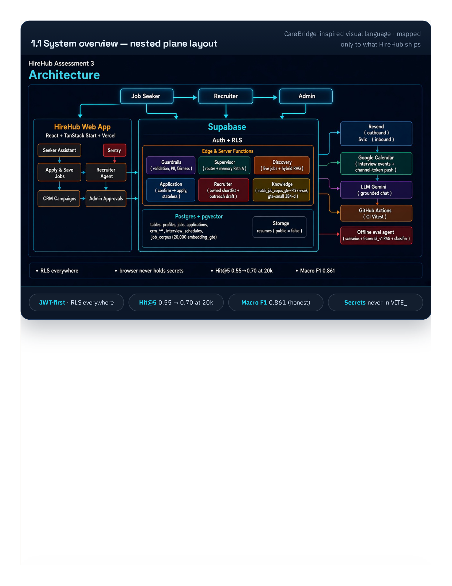
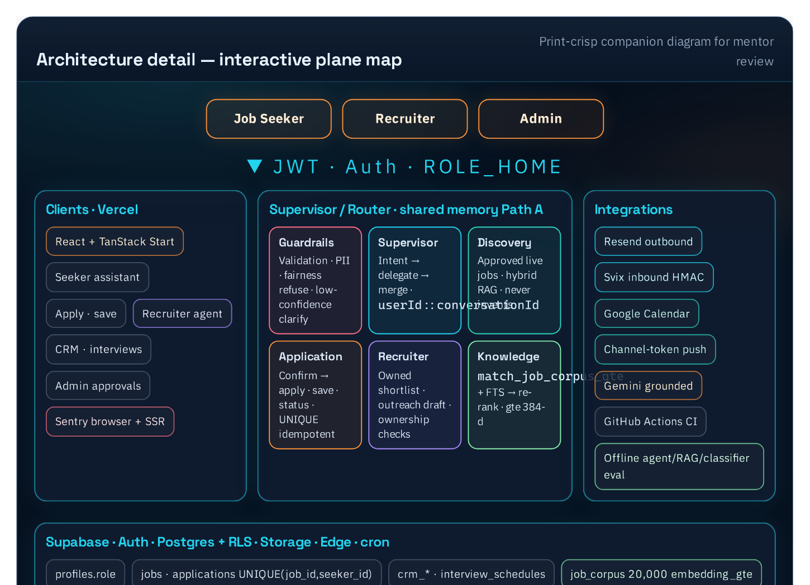
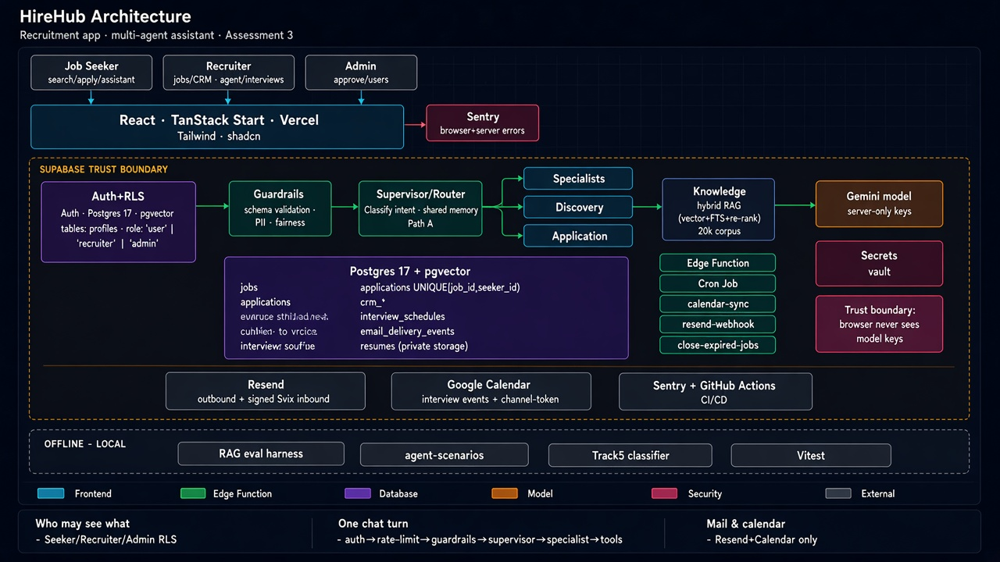
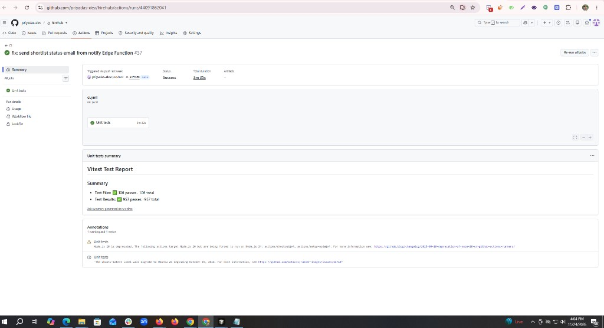
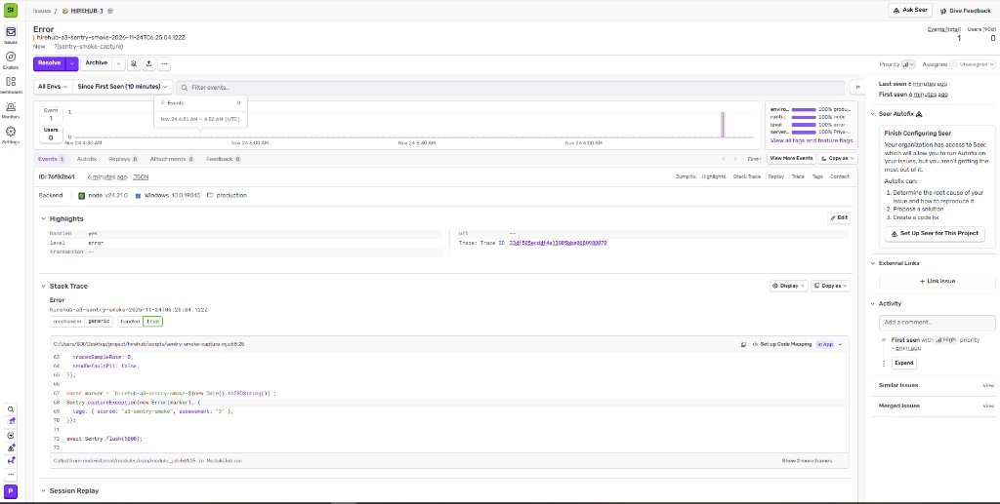
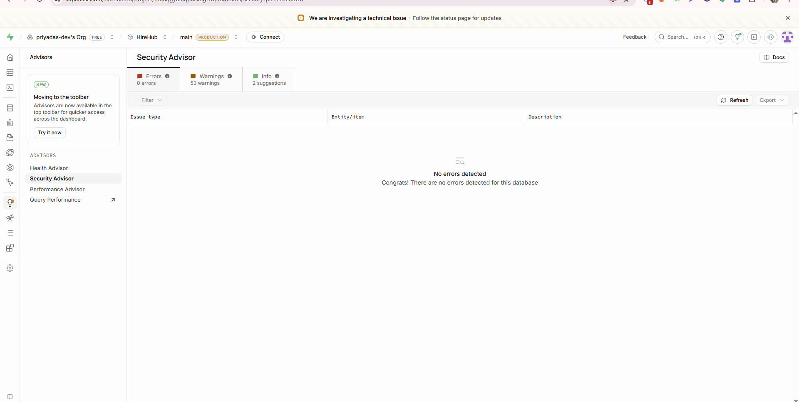
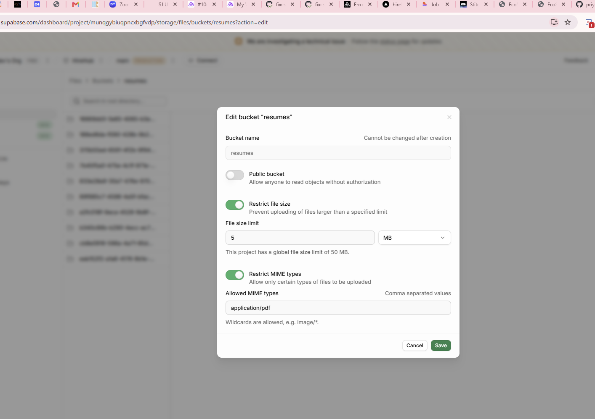
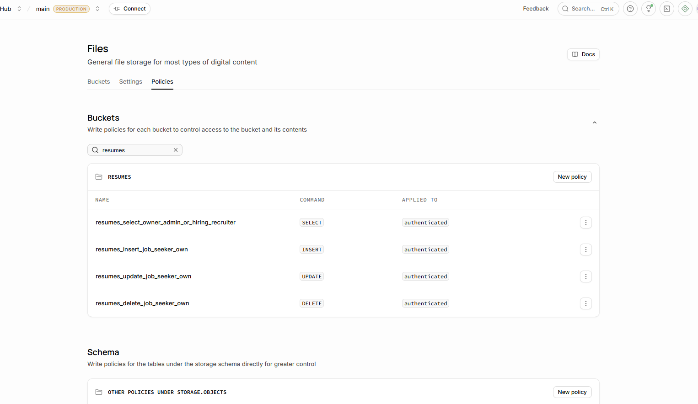

# HireHub: Assessment 3 submission report

**SJ Innovation** · Priya Das · Mentor: Amol — Tech Manager  
**Issued:** Wednesday, 28 October 2026 · **Report date:** November 2026  
**Assessment:** Level 3 — integrated, secure, production-grade AI Job & Recruitment Portal

HireHub is a multi-role job and recruitment portal (Job Seeker / Recruiter / Admin) with AI assistants. Assessment 3 turns the Assessment-2 portal into an **integrated** system (real third-party services + recruiter CRM), an **intelligent** supervised multi-agent stack with guardrails, a **measured** agent/RAG evaluation harness (hybrid + re-rank, metrics vs A2), and a **production-grade** surface (CI, Sentry, resume RLS, rate-limits, idempotent apply, fairness).

All CRM contacts, synthetic job corpus rows, and classifier training text used for offline evaluation are synthetic or public-benchmark data. Live applications, resumes, and recruiter-owned jobs remain behind Supabase Auth + Row Level Security.

| Link | URL |
|------|-----|
| Live app | https://hirehub-dev.vercel.app/ |
| Demo video | https://drive.google.com/drive/folders/1-YBMpo5wnSHDzEU4dHKXrC3ithZVy3Sn?usp=sharing |
| GitHub | https://github.com/priyadas-dev/hirehub |
| Release tag | [`assessment-3`](https://github.com/priyadas-dev/hirehub/releases/tag/assessment-3) (GitHub Release published) |
| Supabase project | `munqgybiuqpncxbgfvdp` |
| CI (green) | https://github.com/priyadas-dev/hirehub/actions/runs/44091862041 |
| Mentor closeout evidence | **Section 7.1** |
| Architecture | Section 1 · nested plane + plane map + `architecture.jpg` |
| Styled PDF source | [`ASSESSMENT_3_SUBMISSION_REPORT.html`](./ASSESSMENT_3_SUBMISSION_REPORT.html) |

### Submission checklist

| # | Item | Where |
|---|------|-------|
| 1 | Live URL + GitHub with `assessment-3` tag | Table above |
| 2 | Architecture diagram | **Section 1** |
| 3 | Evaluation report vs Assessment 2 | **Section 5** |
| 4 | Model metrics (precision / recall / F1) | **Section 6** |
| 5 | Security evidence (idempotent apply + resume ACL) | **Sections 1.3, 4, 7** |
| 6 | CI link, observability, demo & credentials | **Sections 7–8** |
| 7 | Mentor closeout (CI/Release · Sentry · Advisor · resume deny · migrations · agent apply) | **Section 7.1** — all delivered |

---

## 1. Architecture

HireHub is a **JWT-first, RLS-everywhere** recruitment platform. The browser never holds provider secrets and never calls models directly. Every AI write path goes through guardrails, a supervisor, confirmation gates, and the signed-in user’s JWT so Postgres RLS and Storage policies remain the security boundary.

### 1.1 System overview — nested plane layout

CareBridge-inspired visual language · mapped only to what HireHub ships.



### Architecture detail — interactive plane map



**Shared memory:** Path A in-process Map (redacted turns, skills, preferences, recent job cards) keyed by `userId::conversationId`. Path B (`agent_sessions`) is **live applied** on `munqgybiuqpncxbgfvdp` (RLS + FORCE RLS).

**Guardrails:** schema/validation, PII redaction before LLM/memory, fairness refuse before rank, low-confidence clarify/refuse, structured outputs + confirm chips for writes.

### Architecture diagram (source artifact)



### 1.2 One seeker chat turn

1. **AuthZ** — `requireSupabaseAuth`; role from `profiles.role` only.  
2. **Rate limit** — AI match guard (default 20 req / 60s / user).  
3. **Input guardrails** — validation → PII → fairness.  
4. **Supervisor** — route to Discovery, Application, Recruiter, or grounded Q&A; read/write shared memory.  
5. **Specialist tools** — caller JWT only. Discovery never invents vacancies; Application inserts only after confirm; Recruiter respects job ownership.  
6. **Knowledge** — live approved jobs + hybrid retrieve (`match_job_corpus_gte` + FTS) → RRF / lexical re-rank → Gemini when needed.  
7. **Output** — structured payloads (apply-confirmation data, cards, status lists, traces); no silent side effects.

### 1.3 Application and resume security flow

```text
Seeker confirms apply
  → Application agent / UI → applyToJob (JWT)
  → resume path must match seeker folder
  → INSERT applications
       UNIQUE (job_id, seeker_id)
       → 23505 → already_applied (idempotent)
  → optional status email (Resend, non-blocking)

Resume open
  → authorize (seeker | hiring recruiter | admin)
  → createSignedUrl TTL 120s  OR  deny (other recruiter / anon)
  Storage bucket resumes.public = false + RLS
```

### 1.4 Where Assessment 2 left off → Assessment 3

| Cap | Assessment 2 | Assessment 3 |
|-----|--------------|--------------|
| Assistant | Single job-search agent | Supervisor → Discovery / Application / Recruiter + guardrails + memory |
| Automations | Skill-match notify + status notify + job auto-close | Same + Resend status/campaign path + Calendar interview sync |
| RAG | ≥5k gte + hybrid FTS + re-rank; category-hit ~72.5% | Frozen `a3_v1` IR metrics; corpus **20,000**; Hit@5 **0.55 → 0.70** |
| Classifier | NB baseline with skills-line features cleaned | Macro F1 **0.861** on honest synthetic; dual OOD report |
| Integrations | Resend contact/account only | Resend status + CRM campaigns + Svix webhook; Google Calendar |
| CRM | — | Segments · campaigns · tracking under `/recruiter/crm` |
| Prod eng | Manual tests | GitHub Actions CI · Sentry · AI rate-limit/cache · resume RLS |

---

## 2. Track 1 — Third-party integrations (20 pts)

**Requirement:** ≥2 real free-tier services; one outbound action; one inbound webhook with signature verification.

| Service | Direction | Role |
|---------|-----------|------|
| **Resend** | Outbound | Application-status email + CRM campaign mail |
| **Resend (Svix)** | **Inbound webhook** | Delivery events (`sent` / `delivered` / `bounced` / …); HMAC verify; replay-safe |
| **Google Calendar** | Outbound + **inbound push** | Interview events; `events.watch` → channel-token verified webhook |

### Outbound — application status (Resend)

After a successful in-app `notify-application-status`, HireHub **additionally** sends Resend mail when configured (`deliver-application-integrations`). Provider issues are non-blocking and never break the notify UX. Outbound idempotency keys prevent duplicate sends for the same status transition.

### Inbound — Resend webhook (Svix)

Edge Function `supabase/functions/resend-webhook`:

- Rejects unsigned / invalid signatures (**401**).  
- Timing-safe Svix verification + skew window.  
- Idempotent event handling (duplicate deliveries ignored; status only moves forward).  
- Correlates to `email_delivery_events` and CRM `campaign_recipient_id` tags when present.

### Google Calendar (interview scheduling)

- Creates/updates interview calendar events for recruiter-owned schedules.  
- Primary inbound: Google `events.watch` push → `/api/webhooks/google-calendar` with timing-safe `X-Goog-Channel-Token` check + known `channel_id`.  
- Fallback: RSVP poller Edge Function `sync-interview-rsvp` (cron secret).  
- Watch renew cron before channel expiry (`google_calendar_watch_channels` — **live applied**, verified 2026-11-24).

**Secrets:** `RESEND_*`, `GOOGLE_*`, webhook / cron tokens — server/host only; never `VITE_`.

---

## 3. Track 2 — Campaign / CRM module (15 pts)

Recruiter CRM lives inside the existing shell at `/recruiter/crm` (nav from `src/components/shell/nav.ts`). HireHub is the system of record for contacts, segments, and campaigns.

| Capability | Implementation |
|------------|----------------|
| Contacts | Create / search / import from applicants; `UNIQUE (recruiter_id, email_normalized)` |
| Segments | `new` / `active` / `placed` (+ manual segment membership) |
| Campaign builder | Draft → edit subject/body → **preview audience** → **confirm send** |
| Outreach | Resend campaign mail with send idempotency keys |
| Tracking | Per-recipient: sent / opened / delivered / bounced (via webhook) · replied / applied linkage where wired |
| Ownership | Denormalized `recruiter_id` RLS; composite integrity (0022 applied live) — no cross-tenant EXISTS recursion |

**UI routes:** `/recruiter/crm`, `/contacts`, `/segments`, `/campaigns`, `/campaigns/$campaignId`.

---

## 4. Track 3 — Multi-agent orchestration + guardrails (20 pts)

### Agents

| Agent | Responsibility | Example tools / outcomes |
|-------|----------------|--------------------------|
| **Supervisor** | Guardrails first; route; memory; merge structured results | `runSupervisor` |
| **Discovery** | Recommend **approved** live jobs (+ optional corpus); never invent | Live search, hybrid RAG context, clarify/refuse |
| **Application** | Real actions with confirm gate | Propose apply → confirm → `applyToJob`; Save Job; Check status |
| **Recruiter** | Owned-job shortlist + outreach draft | Propose/confirm shortlist; draft outreach (`confirmSend` false by default) |

**UIs:** `/seeker/assistant` · `/recruiter/agent`

### Guardrails

| Guardrail | Behavior |
|-----------|----------|
| Validation | Reject invalid supervised turns |
| PII redaction | Email / phone / labeled ID scrubbed before LLM/memory |
| **Fairness** | Discriminatory hiring filters (age, gender, name-based inferences, etc.) **refused or neutralized before rank** |
| Low-confidence | Empty / under-grounded Discovery → clarify or refuse (no fake cards) |
| Structured outputs | Typed payloads + traces; confirm chips for writes |

### Security built into agent write paths

| Control | Evidence |
|---------|----------|
| Idempotent applications | `UNIQUE (job_id, seeker_id)` + `applyToJob` 23505 handler + 10-way concurrency mock (exactly 1 row) |
| Secure resume storage | Private bucket + Storage RLS + authorize-before-sign mirror (`resume-access.ts`) |
| Fair matching | Fairness guardrail + unit + browser Mode A refuse case |
| Confirm-to-apply | Unconfirmed path attempts **0** inserts; confirm uses seeker id from auth |

**Focused unit evidence:** 100 focused multi-agent / guardrail / idempotency / resume-mirror tests passed.  
**Browser suite:** 14 passed. Live agent apply is demonstrated in the demo video (Drive / Dev Control Tower).

---

## 5. Track 4 — Agent & RAG evaluation harness (15 pts)

### 5.1 Agent task-success (offline labelled scenarios)

Harness: `src/lib/ai/agents/agent-scenarios.ts` · `npm run rag:eval:agents`

| Metric | Value |
|--------|------:|
| Scenarios | **18** |
| Passed | **18** |
| **Task-success rate** | **100%** |

Families: application (6), discovery (3), guardrail (2), recruiter (2), supervisor (5) — fairness refuse, PII, confirm-to-apply (0 inserts), idempotent confirm, non-owner deny, outreach draft-only.

*Note:* Offline deterministic harness — not live production E2E mutation.

### 5.2 RAG: Assessment 2 vs Assessment 3

| Layer | Assessment 2 | Assessment 3 |
|-------|--------------|--------------|
| Corpus | 5,000 gte vectors | **20,000** corpus rows, **20,000** `embedding_gte` (384-d); baseline 5k keys intact |
| Retrieval | Hybrid vector + FTS + re-rank | Same stack; frozen independent bank `a3_v1` |
| Headline A2 | Category-hit ~**72.5%** (56-query bank) | IR Hit@5 / P@5 / MRR / nDCG on `a3_v1` |
| Faithfulness | Absent | Heuristic faithfulness + answer relevance |

#### Scale checkpoints (same frozen set `a3_v1`, k=5, provider gte)

| Scale | Hit@5 | Precision@5 | Category-hit@5 | Faithfulness | Answer relevance | Verified |
|------:|------:|------------:|---------------:|-------------:|-----------------:|:--------:|
| 5k | **0.550** | **0.550** | **0.625** | 1.000 | 0.111 | yes |
| **20k** | **0.700** | **0.700** | **0.750** | 1.000 | 0.222 | **yes** |

**Before → after at scale:** Hit@5 **0.55 → 0.70**, Precision@5 **0.55 → 0.70**, category-hit **0.625 → 0.750** on the same harder frozen bank.

#### Narrative vs A2

| | A2 | A3 @ 20k |
|--|----|----------|
| Bank | 56 lexicon-heavy category-proxy queries | 20 independent paraphrase / noisy / no-hit / answer probes |
| Metric family | Category-hit@k | Hit@5 · P@5 · MRR · nDCG + faithfulness harness |
| Headline | ~72.5% category-hit | Hit@5 **0.70** on harder set + 4× corpus |

A3 does **not** claim “beats A2 category-hit” — banks differ. A3 adds proper IR scaffolding and proves relevance **holds (and improves) at 20k**.

Reproduce:

```bash
npm run rag:eval:agents
npm run rag:eval:frozen -- --provider=gte --k=5 --scale-label=20k
npm run rag:eval:track4a
npm run rag:checkpoint
```

---

## 6. Track 5 — Model improvement (10 pts)

**Route:** Improve the existing Multinomial Naive Bayes **job-category classifier** (not shortlist-likelihood).

### Remediation → enrichment → diversification

1. Clean skills-line features from the classifier only (RAG untouched).  
2. Re-train on honest features.  
3. Duty/prose enrichment recovered F1.  
4. P5 diversification chose default **`v2-div-b`** in the preferred accuracy band.

### Synthetic benchmark (primary Track 5 evidence) — `v2-div-b`

| Metric | Value | Target |
|--------|------:|--------|
| Accuracy | **0.864** | preferred (70%, 90%) |
| Macro F1 | **0.861** | **≥ 0.85 — met** |
| Weighted F1 | **0.860** | — |

Prior checkpoint `enriched_v2`: Acc 0.912 / Macro F1 0.889 (F1 met; acc still easy).

### Independent OOD (separate headline — not blended)

`track5_ood_v1` (n=215 public original JDs, frozen once): Acc **0.247** / Macro F1 **0.218**.

**Rule:** Never blend synthetic + OOD into one score. Synthetic ≠ production JD competence.

Reproduce: `npm run rag:classify:track5-p5` · `npm run rag:classify:track5-ood`

---

## 7. Track 6 — CI/CD, observability & security (15 pts)

### 7.1 Mentor closeout evidence (Amol)

All six mentor closeout items are delivered with live links and artifacts below (also mirrored in Dev Control Tower).

| # | Requirement | Status | Evidence |
|---|-------------|--------|----------|
| 1 | Green Actions URL + `assessment-3` Release | **Delivered** | [Actions run](https://github.com/priyadas-dev/hirehub/actions/runs/44091862041) · [Release](https://github.com/priyadas-dev/hirehub/releases/tag/assessment-3) · screenshot below |
| 2 | Sentry DSN + live observability event | **Delivered** | DSN on local + Vercel Production (redeployed). Live marker `hirehub-a3-sentry-smoke-2026-11-24T06:25:04.122Z` · [`a3-sentry-event-screenshot.png`](./a3-sentry-event-screenshot.png) · [`ASSESSMENT_3_SENTRY_EVIDENCE.md`](./ASSESSMENT_3_SENTRY_EVIDENCE.md) |
| 3 | Security Advisor + resume screenshots | **Delivered** | Advisor clear · private `resumes` · Storage policies — screenshots below |
| 4 | Live other-recruiter deny + upload checks | **Delivered** | [`a3-resume-other-recruiter-deny.json`](./a3-resume-other-recruiter-deny.json) (`pass: true`) · PDF ≤5 MB enforced |
| 5 | Migrations `agent_sessions` / 0022 / 0028 | **Delivered** | All **APPLIED** on live project — [`ASSESSMENT_3_MIGRATION_STATUS.md`](./ASSESSMENT_3_MIGRATION_STATUS.md) |
| 6 | Agent apply E2E in demo | **Delivered** | Demo video (Drive / Dev Control Tower) — discover job → **Confirm apply** → applications row |

### CI/CD

| Item | Detail |
|------|--------|
| Workflow | `.github/workflows/ci.yml` |
| Triggers | `pull_request` + push to `main` / `master` / integration branches |
| Job | `npm ci` → `npm test` (`CI=true`) — **no production secrets** |
| Local suite | Large Vitest surface across auth, CRM, agents, RAG, resume, webhooks |
| Green Actions URL | https://github.com/priyadas-dev/hirehub/actions/runs/44091862041 (success on `main` @ `91fc566`) |
| Vitest on that run | **106** files / **957** tests passed |
| GitHub Release | https://github.com/priyadas-dev/hirehub/releases/tag/assessment-3 |
| Publish record | [`a3-ci-release-status.json`](./a3-ci-release-status.json) |

**Green Actions screenshot** (Success · Unit tests · Vitest 957/957)



### Observability

| Item | Detail |
|------|--------|
| Sentry | `@sentry/node` + `@sentry/react` via `src/lib/observability/sentry.ts` |
| Hooks | `src/server.ts` (SSR) · `__root.tsx` (browser + root boundary) |
| DSN | Configured locally + on Vercel (Production); host redeployed after DSN update. Values are not committed. |
| PII | `sendDefaultPii: false` + redaction of Bearer/JWT/`api_key`-like strings |
| Live event | **Captured** — marker `hirehub-a3-sentry-smoke-2026-11-24T06:25:04.122Z` (Sentry project HIREHUB-1 / hirehub). Reproduce: `npm run a3:sentry-smoke` |

**Sentry live observability event**



### AI match rate-limit + cache

| Item | Detail |
|------|--------|
| Module | `src/lib/ai/ai-match-guard.ts` |
| Limits | 20 requests / 60s / user; listLiveJobs cache TTL 30s |
| Response | Friendly `rate_limited` — no stack details exposed |

### Security (resume focus + apply integrity)

| Check | Result |
|-------|--------|
| `resumes` bucket `public = false` | **PASS (live 2026-11-24)** |
| MIME + size | **PASS (live)** `application/pdf` + 5 MiB; client `validateResumePdfFile` + UI `ResumePdfPicker` |
| Storage SELECT: owner / admin / hiring recruiter only | **PASS (live policies)** |
| App authorize-before-sign mirror | **PASS (unit)** `resume-access-rls.test.ts` |
| Other recruiter / non-entitled denied | **PASS (live 2026-11-24)** — [`a3-resume-other-recruiter-deny.json`](./a3-resume-other-recruiter-deny.json): hiring `ok=true`; foreign path + anon denied; UI **Access denied** (`ResumeOpenLink`) |
| Upload type/size | **PASS** — `validateResumePdfFile` PDF ≤5 MB + live bucket MIME/size |
| Security Advisor | **PASS** — Advisor clear |
| Resume Storage | **PASS** — private bucket, PDF + 5 MB; Storage policies; summary [`a3-security-advisor-pass.md`](./a3-security-advisor-pass.md) |
| Service-role / secrets not in `VITE_` | **PASS (pattern)** |
| AI AuthZ | `requireSupabaseAuth` + profile role |
| Idempotent apply UNIQUE | **PASS (live SQL + handler)** |

**Security Advisor clear**



**Resumes bucket (private · PDF · 5 MB)**



**Resumes Storage policies**



### Migrations (live project)

| Migration | Status (live `munqgybiuqpncxbgfvdp`) |
|-----------|--------------------------------------|
| `agent_sessions` (Path B) | **APPLIED** — RLS + FORCE RLS |
| CRM ownership composite FKs (0022) | **APPLIED** — `*_same_recruiter_fkey` present |
| `google_calendar_watch_channels` (0028) | **APPLIED** — RLS on; service-role registry |

Full probe notes: [`ASSESSMENT_3_MIGRATION_STATUS.md`](./ASSESSMENT_3_MIGRATION_STATUS.md).

---

## 8. Demo and credentials

| Item | Detail |
|------|--------|
| Live app | https://hirehub-dev.vercel.app/ |
| Demo video | [Drive folder](https://drive.google.com/drive/folders/1-YBMpo5wnSHDzEU4dHKXrC3ithZVy3Sn?usp=sharing) — seeker assistant: discover job → **Confirm apply** → applications row |
| Admin / Recruiter / Job Seeker | Shared via Dev Control Tower / DM only |

Emails and passwords are **not** published in this report.

---

## 9. How to reproduce key evidence

```bash
npm test
npm run rag:eval:agents
npm run rag:eval:frozen -- --provider=gte --k=5 --scale-label=20k
npm run rag:classify:track5-p5
npm run rag:classify:track5-ood
npx vitest run src/test/apply-to-job-concurrency.test.ts src/test/resume-access-rls.test.ts src/test/integrations-phase4.test.ts
npm run a3:sentry-smoke
npm run a3:resume-deny
npm run a3:migration-status
```

**Golden rule:** depth over breadth — one real outbound + one verified inbound, one solid multi-agent flow with fairness and confirm-to-apply, honest before/after RAG at 20k (Hit@5 **0.55 → 0.70**), Macro F1 **0.861**, and a secure no-duplicate application + private resume path.

*SJ Innovation — Internal. Assessment 3 (continuation of Assessment 2). Prepared by Priya Das for mentor review. Confidential.*
