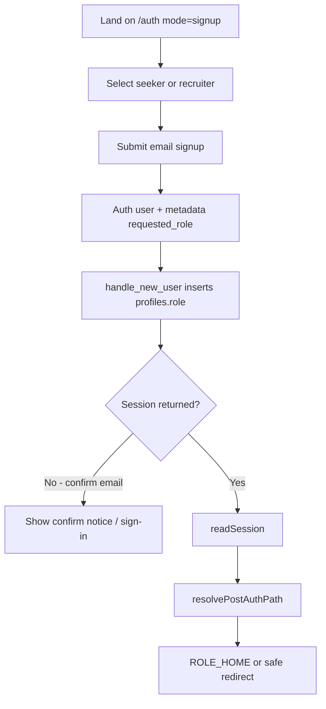
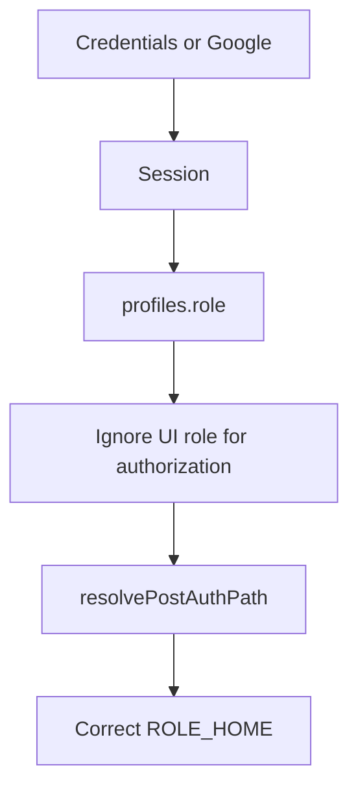

# Authentication Module — Implementation Specification

**Status:** Approved for phased implementation — **Option A locked**  
**Date:** 2026-10-29  
**Phase progress:** Phase 1–4 done · Phase 5 route guards hardened — awaiting smoke  
**Companions:** phase-1 … phase-5 notes under `docs/authentication-phase-*-notes.md` / verification  
**Convention:** Facts verified in source are marked **[Verified]**. Design proposals and assumptions are marked **[Proposed]** / **[Assumption]** / **[Unverified]**.

---

## 1. Executive Summary

HireHub already has a working authentication stack on **Supabase Auth (Lovable Cloud)** with:

- Email/password signup and sign-in
- Google OAuth signup/sign-in
- Password recovery and password change/set
- Role-aware workspaces for **Job Seeker**, **Recruiter**, and **Admin**
- Frontend route guards plus PostgreSQL RLS for authorization

**Overall objective:** Make seeker vs recruiter signup/sign-in predictable and consistent (especially Google), close confirmed gaps and edge cases, and document expected behavior — **without rewriting** the auth provider or inventing a parallel identity system.

**Current product shape (verified):** Role is chosen **before** authentication on `/auth` (“I am a…”). Email signup persists `requested_role` into Auth metadata and the DB trigger writes `profiles.role`. Google cannot pass signup metadata the same way, so the app stashes the choice and, for **new** Google users requesting recruiter, claims the role once via a server function.

**Recommended direction:** Keep and harden the existing **pre-auth role selection** model (Option A), with the existing **post-OAuth claim** as the Google-specific bridge (a limited Option C). Do **not** introduce a nullable “role unassigned” onboarding state unless product explicitly wants post-auth role picking (Option B).

---

## 2. Existing Architecture

### 2.1 Provider and session

| Piece | Location | Notes |
| --- | --- | --- |
| Auth provider | Supabase Auth via Lovable Cloud | **[Verified]** |
| Browser client | `src/integrations/supabase/client.ts` | Persist session, auto refresh, URL session detection |
| Session reader | `src/lib/auth.tsx` → `readSession()` | Uses `supabase.auth.getUser()` then `profiles` |
| React context | `AuthProvider` / `useAuth` in `src/lib/auth.tsx` | `user`, `loading`, `profileError`, `refresh`, `signOut` |
| ServerFn bearer attach | `src/integrations/supabase/auth-attacher.ts` + `src/start.ts` | Client middleware attaches `Authorization: Bearer` |
| ServerFn auth check | `src/integrations/supabase/auth-middleware.ts` → `requireSupabaseAuth` | Validates JWT via `getClaims` |
| CSRF on serverFns | `createCsrfMiddleware` in `src/start.ts` | **[Verified]** |

**Role source of truth:** `public.profiles.role` only. Browser intent / radio selection is never authorization. Documented in `AGENTS.md` and enforced in `mapDbRole` / `readSession`.

### 2.2 Database model

**[Verified]** from `drizzle/migrations/0000_hirehub_core_schema.sql` and `0001_signup_role_choice.sql`:

```text
user_role ENUM: job_seeker | recruiter | admin
profiles.id → auth.users(id) ON DELETE CASCADE
profiles.role NOT NULL DEFAULT 'job_seeker'
```

| Mechanism | Behavior |
| --- | --- |
| `handle_new_user` (trigger on `auth.users` INSERT) | Creates profile; if `raw_user_meta_data.requested_role = 'recruiter'` → `recruiter`, else `job_seeker` |
| `protect_profile_role` | Blocks non-admin role UPDATEs (base migration). `PROPOSED_0007_bootstrap_admin_role_guard.sql` relaxes service-role / no-JWT bootstrap — **live apply status: confirm in Phase 1 SQL checklist** |
| RLS | Own/admin read/update profiles; companies/jobs/applications policies call `current_role_is(...)` |
| Admin creation | Never via signup; bootstrap SQL in `src/lib/assignment-verification.ts` |

App role mapping (`src/lib/auth.tsx`):

| DB | App |
| --- | --- |
| `job_seeker` | `seeker` |
| `recruiter` | `recruiter` |
| `admin` | `admin` |
| missing / unknown | `null` → `ProfileSessionError` (no silent default to seeker) |

### 2.3 Key modules

| Concern | Files |
| --- | --- |
| Auth UI | `src/routes/auth.tsx` |
| Intent helpers | `src/lib/auth-intent.ts` |
| Email signup / passwords | `src/lib/account-password.ts` |
| Google role stash/claim rules | `src/lib/oauth-signup-role.ts` |
| Google recruiter claim RPC | `src/lib/claim-oauth-signup-role.ts` |
| Account delete | `src/lib/delete-own-account.ts` |
| Profile contact updates (never role) | `src/lib/profile.ts` |
| Forgot / reset UI | `src/routes/forgot-password.tsx`, `src/routes/reset-password.tsx` |
| Recovery session | `src/lib/password-recovery.ts`, `src/lib/account-mail.ts` |
| Backup transactional mail | `src/lib/send-account-mail.ts` |
| Nav by role | `src/components/shell/nav.ts` |
| Welcome overlay | `src/lib/role-welcome.ts` |
| Unit coverage | `src/test/auth-role-routing.test.ts`, `oauth-signup-role.test.ts`, `auth-intent.test.ts`, `account-password.test.ts` |

### 2.4 Routes (auth-relevant)

**Public**

- `/` — marketing; role cards pass `?intent=seeker|recruiter`
- `/auth` — sign-in / sign-up
- `/forgot-password`, `/reset-password`
- `/support` (and other marketing) — not auth-gated

**Authenticated shell** — pathless `/_app` (`src/routes/_app.tsx`)

- Requires successful `readSession()`; else redirect to `/auth?redirect=…`
- Shared: `/settings`, `/dashboard` (redirects to `ROLE_HOME[role]`)

**Role layouts**

- `/_app/seeker/*` → must be `seeker`
- `/_app/recruiter/*` → must be `recruiter`
- `/_app/admin/*` → must be `admin`
- Wrong role → redirect to that user’s `ROLE_HOME` (not 403 page)

**Homes:** `ROLE_HOME` = `/seeker` | `/recruiter` | `/admin`

### 2.5 Dependencies

- `@supabase/supabase-js`, TanStack Start server functions, Zod, Resend (optional backup mail)
- Env: `VITE_SUPABASE_URL`, `VITE_SUPABASE_PUBLISHABLE_KEY`, server `SUPABASE_URL`, `SUPABASE_PUBLISHABLE_KEY`, `SUPABASE_SERVICE_ROLE_KEY` (required for Google recruiter claim + account delete)

---

## 3. Current Flow Analysis

### 3.1 Manual email signup **[Verified]**

1. User opens `/auth` (often `mode=signup`, optional `intent`).
2. Selects Job Seeker or Recruiter (`SignupRole`: `job_seeker` | `recruiter`).
3. Submits name/email/password → `signUpWithAccountEmail` with metadata `{ full_name, requested_role }`.
4. DB trigger creates `profiles` with matching role (admin never grantable).
5. If no session (email confirm required): notice + optional Resend backup mail; switch to sign-in.
6. If session present: `refresh()` → toast → `resolvePostAuthPath(role, redirect)`.

Password UI validation on signup: **min 8 / max 128 only** (auth page schema). Stronger letter+number rule exists in `passwordStrengthIssue` but is **not** applied on signup.

### 3.2 Manual email sign-in **[Verified]**

1. `signInWithPassword`.
2. `refresh()` loads `profiles.role`.
3. Navigate via `resolvePostAuthPath` (ignores cross-role redirects).
4. UI role radio does **not** change existing roles.

### 3.3 Google OAuth **[Verified]**

1. Always `stashOAuthSignupRole(role)` + `buildGoogleOAuthRedirectTo` embeds `intent` (and `mode=signup` when applicable).
2. `signInWithOAuth({ provider: "google", skipBrowserRedirect: true })` then `location.assign`.
3. Return to `/auth` with session; effect peeks stash / intent.
4. If pending role is recruiter → `planPostGoogleAuth` → `claimOAuthSignupRole` serverFn (service role).
5. Claim applies **only** when: Google identity, current role `job_seeker`, account created within **15 minutes**, requested `recruiter`.
6. Otherwise keep DB role; may toast skip reason for existing seekers.
7. Clear stash; go home.

**Seeker Google path:** no claim needed — trigger default `job_seeker` stands.

### 3.4 Sign-out **[Verified]**

`signOut` clears welcome session storage + `supabase.auth.signOut()`. Protected routes then redirect to `/auth`.

### 3.5 Password recovery **[Verified]**

Forgot → `resetPasswordForEmail` with redirect allowlist fallbacks + optional Resend copy. Reset page establishes recovery session (hash or PKCE), then `updateUser({ password })`, then role home.

### 3.6 “Onboarding” today

There is **no** auth-level “role unassigned” or “onboarding incomplete” flag.

| Role | Post-auth product step | Gated? |
| --- | --- | --- |
| Seeker | Profile/resume optional; can browse immediately | Soft UX, not auth gate |
| Recruiter | Company profile needed before posting jobs | Soft gate on job create UI + RLS |
| Admin | Bootstrap only | N/A |

Session welcome overlay (`RoleWelcome`) is cosmetic, not authorization.

### 3.7 Account deletion / re-role **[Verified]**

Seekers/recruiters can delete via `deleteOwnAccount` (service role). Same email can sign up again and pick role. Admins cannot self-delete from Settings.

---

## 4. Problems and Gaps

### Confirmed

| ID | Issue | Evidence |
| --- | --- | --- |
| P1 | Signup password rules weaker than change/reset | `auth.tsx` schema vs `account-password.ts` |
| P2 | Google recruiter claim fragile: UPDATE may fail under `protect_profile_role`; falls back to **delete+insert** profile row | `claim-oauth-signup-role.ts` |
| P3 | Claim + delete depend on `SUPABASE_SERVICE_ROLE_KEY`; misconfig → recruiter Google signup fails / stuck seeker | Claim handler messages |
| P4 | Claim timeout / failure after Google creates seeker profile can leave **wrong role** with no retry UI | Auth effect + 15‑min window |
| P5 | Role picker shown on **Sign in** tab confuses “signing in as X” vs saved role | `auth.tsx` copy + radio always visible |
| P6 | Existing Google seeker cannot become recruiter without delete+re-signup | `shouldApplyOAuthSignupRole` |
| P7 | Manual signup duplicate detection relies on empty `identities` heuristic | `auth.tsx` |
| P8 | Project-specific Google error toast embeds live project ref | `auth.tsx` OAuth error effect |
| P9 | No first-class “authenticated but role pending” state — Option B not supported by schema | `profiles.role NOT NULL` |
| P10 | Jobs index copy says company “active immediately” while schema/policies treat companies as `pending` until admin approval | Product inconsistency (adjacent to auth onboarding) |

### Suspected / unverified

| ID | Item | Notes |
| --- | --- | --- |
| S1 | Whether `PROPOSED_0007` is applied on live Supabase | Affects whether service-role UPDATE works without delete+insert |
| S2 | Supabase “automatic linking” of Google ↔ same email password account | Behavior is dashboard config; app has no explicit link/unlink UI |
| S3 | Email confirmation required in prod vs local | Branching already coded; env-dependent |
| S4 | Rate-limit / CAPTCHA settings on Supabase Auth | App only surfaces provider messages |
| S5 | Whether delete+insert drops additive profile columns not listed in insert payload | Skills / future columns risk data loss on claim fallback |

### What works well (reuse)

- `profiles.role` + `protect_profile_role` + RLS as security backbone
- `resolvePostAuthPath` / open-redirect hardening
- Role layout `beforeLoad` guards
- OAuth intent + sessionStorage dual channel with unit tests
- Password recovery redirect plumbing
- Account delete as intentional path to re-choose role

---

## 5. User Types and Role Model

### Representation **[Verified + Proposed keep]**

- Persist only `job_seeker` | `recruiter` | `admin` in DB.
- Public signup may request only seeker/recruiter.
- Admin is ops bootstrap, never self-serve.

### Enforcement points (not UI-only)

1. **Route:** `_app` auth gate; `_app.seeker|recruiter|admin` role gates.
2. **RLS:** `current_role_is` on mutations (apply, post job, create company, etc.).
3. **ServerFns / domain:** e.g. `assertSeekerRole` in job assistant; claim/delete check role server-side.
4. **Client profile updates:** omit `role` from update payloads (`profile.ts`).

**[Proposed]** Treat company setup as **recruiter product onboarding**, separate from authentication completion. Do not block `/recruiter` dashboard solely for missing company unless product requires it.

---

## 6. Proposed Authentication UX

### Options evaluated

#### Option A — Choose role before authentication

**What exists today.** Marketing `intent`, `/auth` radios, email `requested_role`, Google stash+claim.

| Pros | Cons |
| --- | --- |
| Fits current schema (role always set) | Google needs extra claim path |
| Fewest new tables/states | Wrong early choice hard to undo (delete or admin) |
| Matches “recruiters explicitly choose path” | Sign-in role UI can confuse |

#### Option B — Authenticate first, then choose role

Requires nullable / sentinel role, blocking routes until selection, migration + backfill.

| Pros | Cons |
| --- | --- |
| Cleaner Google (no pre-redirect stash) | Schema + guard rewrite |
| Clear “incomplete” user state | Privilege window if gates miss |
| | Larger change than problem warrants |

#### Option C — Hybrid

Pre-select when possible; post-auth selection when missing.

| Pros | Cons |
| --- | --- |
| Flexible | Two mental models |
| Helps abandoned Google claim | Needs pending-role state Option A largely avoided |

### Recommendation **[Proposed — needs approval]**

**Adopt Option A (current), harden Google claim (limited C only for the OAuth metadata gap).**

Reasons:

1. Architecture already encodes A; rewrite to B is high cost.
2. Security model assumes every profile has a concrete role.
3. Google gap is already partially solved; fixing claim reliability is smaller than inventing post-auth role selection.
4. Product default seeker path + explicit recruiter choice already matches landing/role cards.

**Do not** add free self-serve role switching after registration (privilege / data-integrity risk). Role change paths remain: admin Users page, or delete account and re-signup.

---

## 7. Flow Diagrams

### 7.1 Manual signup



### 7.2 Google signup / first-time sign-in

```mermaid
flowchart TD
  A[Select role on /auth] --> B[stash + redirectTo intent]
  B --> C[Google consent]
  C --> D{Success?}
  D -->|Cancel/error| E[/auth error toast]
  D -->|OK| F[Session + profile default job_seeker]
  F --> G{Pending recruiter?}
  G -->|No| H[goHome as seeker or existing role]
  G -->|Yes| I[claimOAuthSignupRole]
  I --> J{Applied?}
  J -->|Yes| K[recruiter home]
  J -->|No / timeout| L[Keep DB role + message]
```

### 7.3 Sign-in (email or Google, existing user)



### 7.4 Protected route access

```mermaid
flowchart TD
  A[Request /_app/*] --> B{readSession OK?}
  B -->|No / profile error| C[/auth?redirect=...]
  B -->|Yes| D{Path role layout match?}
  D -->|No| E[Redirect ROLE_HOME]
  D -->|Yes| F[Render + RLS on data]
```

---

## 8. Scenario Matrix

| Scenario | Expected behavior (intended) | Current status |
| --- | --- | --- |
| New seeker, email | Role `job_seeker`; confirm if required; then `/seeker` | Works |
| New recruiter, email | Role `recruiter` via trigger; `/recruiter` | Works if metadata + migration 0001 applied |
| New seeker, Google | Default seeker; home `/seeker` | Works |
| New recruiter, Google | Claim within window → `recruiter` | Works when service role OK; fragile (P2–P4) |
| Existing seeker, email/Google | Home `/seeker`; UI role ignored | Works |
| Existing recruiter, email/Google | Home `/recruiter` | Works |
| Authenticated, no role selected | N/A under Option A — role always set at insert | No pending state |
| Abandon email signup mid-form | No account | Works |
| Cancel Google | Stay/return `/auth`; stash cleared on start failure | Mostly works |
| Partial onboarding (no company) | Recruiter can enter workspace; job post nudges company | Soft only |
| Protected page while logged out | `/auth?redirect=…` | Works |
| Wrong role URL | Redirect to own home | Works |
| Invalid / missing profile role | `profileError`; sign-out CTA; `_app` → `/auth` | Works |
| Expired session | Treated as logged out | Works (provider) |
| Password reset success | Update password → role home | Works |

**Distinction reminder**

| Concern | Meaning |
| --- | --- |
| Signup | Create Auth user + profile |
| Signin | Establish session for existing user |
| Role selection | Public intent before create (A) |
| Product onboarding | Company/resume completeness |
| Authorization | `profiles.role` + RLS + route guards |

---

## 9. Edge-Case Register

Priority: **P0** immediate / security · **P1** next hardening phase · **P2** later · **OK** already handled · **N/A** not applicable under current architecture

| Case | Expected | Priority | Notes |
| --- | --- | --- | --- |
| Duplicate email registration | Friendly “already exists”; no second profile | P1 | Heuristic + Supabase errors |
| Google email already used by password account | Single identity per Supabase linking policy; clear message | P1 | **[Unverified]** provider config |
| Link/unlink providers | Out of scope unless product asks | P2 / N/A | No UI today |
| Google email verification / missing profile fields | Profile from trigger + metadata fallbacks in `readSession` | OK / P2 | Name fallbacks exist |
| Legacy accounts without role | Invalid role → block workspace | OK | No invent-seeker |
| Tampered `intent` / stash | Claim rules reject; existing role wins | OK | Never trust client for authz |
| Change role mid-signup before submit | Last UI selection used | OK | |
| Change role after registration | Denied for self; admin or delete+re-signup | OK / product Q | |
| Refresh / back during OAuth claim | Peek stash; clear after claim; Strict Mode aware | OK-ish | Timeout risk P4 |
| Open onboarding URL directly | No dedicated role-pending route | N/A under A | |
| Bypass role via API | RLS + trigger | OK | |
| Interrupted signup (confirm pending) | User exists unconfirmed; sign-in blocked until confirm | OK | Env-dependent |
| Bad password / unknown email | Generic invalid credentials copy | OK | |
| Rate limits | Surface 429-ish messages | OK / P2 | Provider-side |
| Stale session / signout | Clear client; guard redirects | OK | |
| Multi-tab | Shared storage; last write wins | OK | |
| OAuth callback errors | Toast + strip error params | OK | |
| Open redirects | `normalizeAuthRedirect` + role-scoped resolve | OK | |
| Client-controlled role escalation | Blocked | OK | Claim never grants admin |
| Partial claim delete+insert failure | Attempt restore `job_seeker` | P0 | Data-loss risk if restore fails |
| CSRF on serverFns | Middleware present | OK | |
| Audit of role changes | Admin UI only; no audit table | P2 | |

---

## 10. Security Considerations

1. **Authorization never from browser role radios** — only `profiles.role`.
2. **OAuth intent is a hint**, gated by `shouldApplyOAuthSignupRole`.
3. **Service role** required for claim/delete — keep off client; presence-checked only in responses.
4. **Delete+insert claim bypass** is the highest integrity risk; prefer trigger-compatible UPDATE (apply `PROPOSED_0007` or a dedicated SECURITY DEFINER claim function) **[Proposed]**.
5. **Password storage** — Supabase Auth only; HireHub never persists passwords.
6. **Redirect allowlists** — document in `assignment-verification.ts`; misconfig breaks Google/reset.
7. **Account enumeration** — forgot-password uses generic success copy; signup duplicate messages are more revealing (acceptable tradeoff; tighten if required).
8. **Self-serve role change** after data exists (applications/jobs) is unsafe without migration rules — do not enable casually.

---

## 11. Database and Migration Impact

**[Proposed] Minimal for Option A harden:**

| Change | Need? |
| --- | --- |
| Nullable role / pending enum | **No** (unless Option B chosen) |
| Confirm `0001_signup_role_choice` on live | Verify |
| Apply or replace `PROPOSED_0007` so service-role UPDATE of role works without delete+insert | Strongly recommended |
| Optional: `claim_oauth_recruiter_role(uid)` SECURITY DEFINER with same predicates as TS | Preferred over delete+insert |
| Backfill | Only if orphaned Auth users without profiles found |
| Legacy wrong-role Google recruiters | Support/delete+re-signup or admin fix |

---

## 12. API and Frontend Changes (when approved)

Likely touch list (implementation later):

| Area | Files |
| --- | --- |
| Auth UX clarity | `src/routes/auth.tsx` |
| Password parity | `src/routes/auth.tsx`, `src/lib/account-password.ts` |
| Claim reliability | `src/lib/claim-oauth-signup-role.ts`, possibly SQL migration |
| OAuth helpers | `src/lib/oauth-signup-role.ts` (retry / messaging) |
| Tests | existing auth unit tests + new claim/integration cases |
| Docs / env | `.env.example`, deploy notes |

**Out of scope unless approved:** new auth provider, Option B schema, provider link/unlink UI, CAPTCHA product, full audit log system.

---

## 13. Testing Strategy

| Layer | Coverage |
| --- | --- |
| Unit | Keep/extend `auth-role-routing`, `oauth-signup-role`, `auth-intent`, `account-password` |
| Unit (new) | Password schema shared on signup; claim skip/apply matrix; redirect normalization regressions |
| Integration | ServerFn claim with mocked admin client; delete-own-account role gates |
| E2E (manual/Playwright) | Email seeker/recruiter signup; Google seeker; Google recruiter within window; existing user ignores UI role; cross-role URL redirect; reset password; signout |
| Security | Cannot self-promote via profile update; claim rejects admin / old accounts / email-only; open redirect negatives |

---

## 14. Implementation Roadmap

### Phase 0 — Product decisions (this review)

- Approve Option A (recommended) vs B/C
- Approve “no self-serve role switch” vs allow with rules
- Approve claim strategy: SQL function vs keep delete+insert after 0007

**Exit:** Signed-off answers in §16.  
**Status:** **Complete** — Option A + D1–D7 locked (see §15 / Phase 1 doc).

### Phase 1 — Spec lock + live verification

- Confirm live migrations (`0001`, `0007`), Google redirect URLs, service role env
- Inventory any users stuck as seeker after failed recruiter Google signup

**Acceptance:** Written verification notes; no code required beyond docs if needed.  
**Status:** **Approved** (checks 1–5 Pass, 2026-10-29).

### Phase 2 — Role model & claim integrity (MVP security)

- Replace delete+insert with safe role update path
- Harden claim errors / optional one-shot retry within window
- Ensure email `requested_role` path documented and tested

**Acceptance:** New Google recruiter ends as `recruiter` without profile row delete; existing roles never overwritten.  
**Status:** **Done** — function live; history stubs added; see Phase 2 notes.

### Phase 3 — Manual signup/signin polish

- Align password strength on signup with shared rules
- Clearer duplicate/confirm/rate-limit copy
- Sign-in tab: de-emphasize or hide role radios for pure returning users **[product]**

**Acceptance:** Email seeker/recruiter flows match scenario matrix; unit tests green.  
**Status:** **Code complete** — role selection Sign up only; see `docs/authentication-phase-3-notes.md`.

### Phase 4 — Google UX & persistence

- Messaging when claim skipped (existing seeker)
- Ensure intent+stash failover covered; cancel/error paths clear busy state
- Remove hardcoded project-specific toast detail or gate behind dev **[Proposed]**

**Acceptance:** Documented Google matrix passes on localhost + deployed origin.  
**Status:** **Code complete** — both roles; Admin sign-in unchanged; see `docs/authentication-phase-4-notes.md`.

### Phase 5 — Route protection review

- Audit only; small fixes if any guard gaps found
- Keep RLS as source of truth; no new invented routes

**Acceptance:** Cross-role navigation redirects; unauthenticated redirect preserves safe path.  
**Status:** **Code complete** — see `docs/authentication-phase-5-notes.md`.

### Phase 6 — Recovery & edge cases

- Password reset allowlist checklist
- Claim failure recovery UX (sign out / support / delete+retry)
- Company copy consistency (pending vs active) if in scope

**Acceptance:** Ops checklist documented; claim failure offers recovery actions; company copy says pending.  
**Status:** **Approved** (2026-10-30) — see `docs/authentication-phase-6-notes.md`.

### Phase 7 — Automated tests & regression

- Expand unit + selective E2E; update LIVE_DEMO_CHECKLIST

**Acceptance:** Auth unit regression suite green; selective Playwright auth smoke (skips without `E2E_SEEKER_*`); LIVE_DEMO_CHECKLIST current.  
**Status:** **Approved** (2026-10-30) — see `docs/authentication-phase-7-notes.md`.

### MVP vs defer

| MVP | Defer |
| --- | --- |
| Safe Google recruiter claim | Option B pending-role |
| Password rule parity | Provider link/unlink |
| Sign-in role UX clarity | Audit log table |
| Env/migration verification | CAPTCHA / advanced rate limit UI |
| | Self-serve role switch |

---

## 15. Open Questions and Assumptions

### Assumptions (challenge if wrong)

1. Job Seeker remains the default when no marketing intent is present.
2. Recruiters must explicitly choose Recruiter before signup (already UI).
3. Self-serve role change after registration is **not** desired.
4. Company/resume completion is product onboarding, not auth completion.
5. Admin remains bootstrap-only.

### Decisions (locked 2026-10-29 — Option A path)

| # | Decision | Locked |
| --- | --- | --- |
| D1 | Role selection timing: A / B / C | **A + harden Google claim** |
| D2 | Keep delete-account as only user-driven re-role path? | **Yes** |
| D3 | Replace claim delete+insert with SQL/security definer update? | **Yes (Phase 2)** |
| D4 | Hide / de-emphasize role picker on Sign-in | **Yes, lightly** (Phase 3) — still stash role if Google from sign-in can create accounts |
| D5 | Allow admin-assisted seeker→recruiter without delete? | **Yes via admin / SQL; no self-serve** |
| D6 | Require company before any `/recruiter/*` access? | **No** — soft gate on posting |
| D7 | Email confirmation required in production? | **Record Supabase setting in Phase 1 checklist; no silent app change** |

---

## 16. Approval Gate

| Gate | Status |
| --- | --- |
| Option A + D1–D7 | **Locked** |
| Phase 1 agent verification | **Done** |
| Phase 1 human Dashboard/SQL checklist | **Approved** (1–5 Pass) |
| Phase 2 claim integrity | **Done** (`claim_oauth_recruiter_role` live) |
| Phase 3–4 | **Code complete** (treat approved via continue to Phase 5) |
| Phase 5 route protection | **Code complete** — await smoke approval |
| Phase 6 | **Approved** (2026-10-30) |
| Phase 7 | **Approved** (2026-10-30) — auth roadmap complete |

---

## Appendix A — File index (investigation)

- `src/lib/auth.tsx`, `auth-intent.ts`, `oauth-signup-role.ts`, `claim-oauth-signup-role.ts`
- `src/lib/account-password.ts`, `account-mail.ts`, `password-recovery.ts`, `delete-own-account.ts`, `profile.ts`
- `src/routes/auth.tsx`, `forgot-password.tsx`, `reset-password.tsx`, `_app.tsx`, `_app.seeker.tsx`, `_app.recruiter.tsx`, `_app.admin.tsx`, `_app.dashboard.tsx`, `_app.settings.tsx`, `index.tsx`
- `src/integrations/supabase/client.ts`, `auth-attacher.ts`, `auth-middleware.ts`, `client.server.ts`
- `src/start.ts`, `src/components/shell/nav.ts`
- `drizzle/migrations/0000_hirehub_core_schema.sql`, `0001_signup_role_choice.sql`, `PROPOSED_0007_bootstrap_admin_role_guard.sql`

## Appendix B — Glossary

| Term | Meaning |
| --- | --- |
| Intent | Public `seeker` \| `recruiter` query hint |
| SignupRole | `job_seeker` \| `recruiter` UI/DB public roles |
| Claim | Post-Google one-time seeker→recruiter for brand-new accounts |
| ROLE_HOME | Canonical workspace path per app role |
